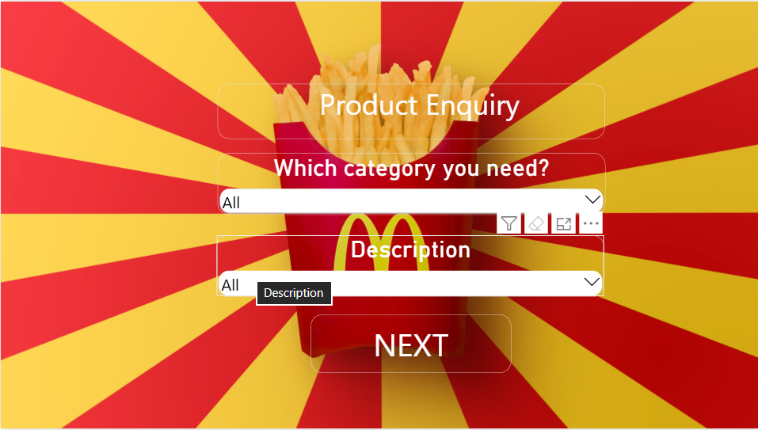
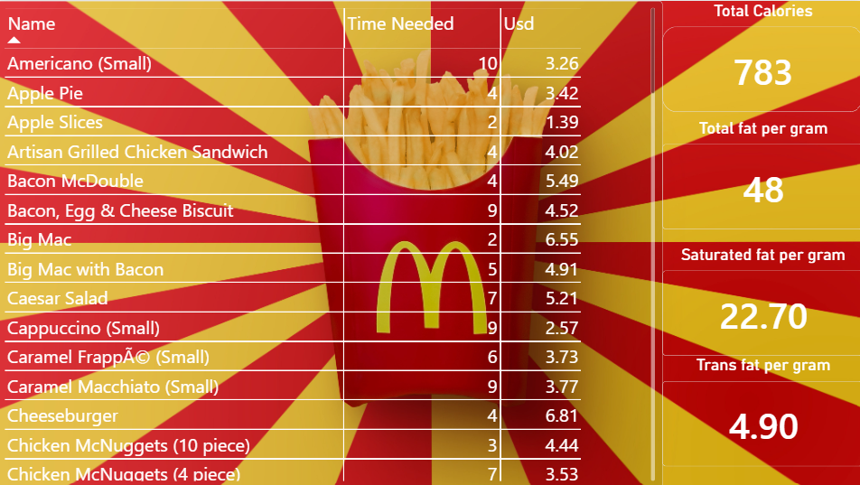

# McDonald's Product Information Dashboard

An interactive **Power BI dashboard** designed to help users quickly explore McDonald's US menu products and understand their key product and nutritional information.

## 🎯 Objective

The goal of this project is to make product information easier to explore through a simple customer-focused dashboard.

**Find a product → Understand the product → Make an informed choice**

Instead of creating generic charts from the dataset, the dashboard focuses on answering a practical question:

> **"What do I need to know about this product?"**

## 📊 Dashboard

### Page 1 — Product Selection

The first page allows the user to:

* Select a **food category**
* Select a **specific product**
* View the product **description**
* Navigate to the detailed product information page

### Page 2 — Product Information

The second page provides detailed information about the selected product, including:

* Product name
* Price
* Preparation time
* Calories
* Total fat
* Saturated fat
* Trans fat

The product table and information cards update dynamically based on the selected product.

## 💡 Key Design Decision

The dataset contains nutritional fields such as:

* Total Fat
* Saturated Fat
* Trans Fat

These values were intentionally displayed as **separate information cards** rather than a percentage/composition chart.

They are not additive components that should be represented as parts of a 100% total.

## 🛠️ Tools Used

* **Power BI**
* **Power Query**
* **DAX**
* **Microsoft Excel / CSV**

## 📁 Project Structure

```text
McDonalds-Product-Information/
│
├── README.md
│
├── data/
│   └── mcdonalds_2026_dataset.csv
│
├── powerbi/
│   └── Macdonalds-Product-Information.pbix
│
└── screenshots/
    ├── page1.png
    └── page2.png
```

## 📌 Key Learning

Through this project, I practiced:

* Understanding a dataset before creating visualizations
* Identifying meaningful analysis instead of forcing unnecessary charts
* Defining a clear user-focused problem
* Designing a simple dashboard workflow
* Using slicers and filter context
* Implementing cross-page navigation in Power BI
* Presenting nutritional information clearly
* Using DAX and Power BI for interactive analysis

## 📷 Dashboard Preview

### Product Selection



### Product Information



## 🚀 Outcome

The final result is a simple interactive dashboard that allows users to select a McDonald's product and quickly understand its key information.

This project is part of my **Data Analysis and Data Science portfolio**.
